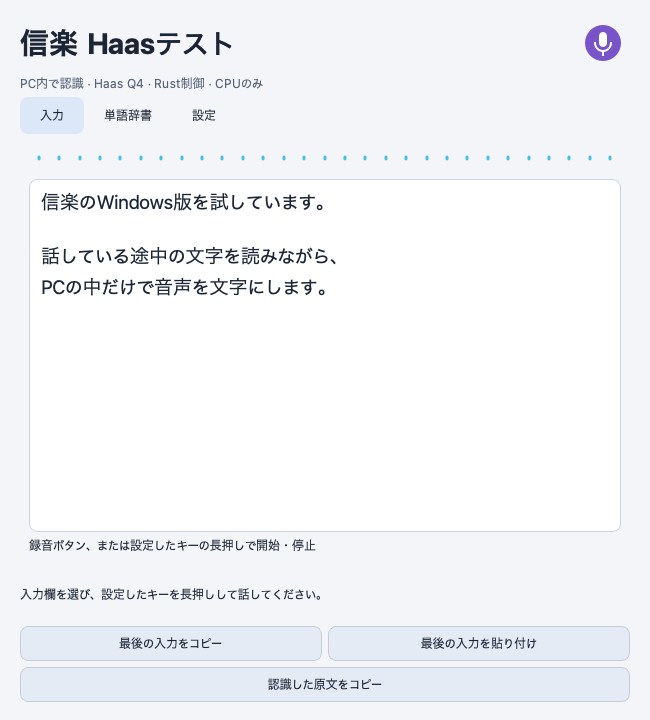

# 信楽 — Haasを使ったローカル日本語音声入力

Windows向けのベータ版です。左Ctrlを押して話すと、録音中から途中字幕を表示し、キーを離すと入力先へ貼り付けます。GPUや推論APIの契約は不要です。

音声認識には、[Third IntelligenceのHaas-ja-v1.0](https://huggingface.co/third-intelligence/Haas-ja-v1.0)を使用しています。[SakasegawaによるGGUF変換版](https://huggingface.co/sakasegawa/Haas-ja-v1.0-GGUF)を、[speech.cpp](https://github.com/nyosegawa/speech.cpp)のCPUエンジンで実行します。これらの成果に支えられて、信楽は録音・途中字幕・辞書・他アプリへの転記を一つの操作にまとめています。

図は同じ画面コードから生成したプレビューです。Windows実機のスクリーンショットではありません。

## ダウンロードと使い方

[ベータ版のダウンロード](https://github.com/k3peta/shigaraki/releases/tag/v0.1.0a3-haas)から、`Shigaraki-Haas-Preview-0.1.0a3-setup.exe`を取得してください。[図入り導入ガイド](docs/INSTALL.md)に、インストール・モデル準備・マイク・操作方法をまとめています。

- 小窓で入力：入力欄を選び、左Ctrlを長押しして話します。離すと確定して貼り付けます。
- 大ウィンドウ：録音していないときに、左Ctrlを短く2回押すと開閉できます。
- 連続入力：大ウィンドウの録音ボタン、または左Ctrl長押しで開始し、もう一度操作すると停止して貼り付けます。
- 認識結果の回収：転記に失敗しても、大ウィンドウの「最後の入力をコピー」から文章を取り出せます。

大ウィンドウが開いている間、小窓は表示しません。通常版の信楽もインストールできますが、起動して使うのは一方だけです。キーは設定で変更できます。

## 使っている技術

| 用途 | 採用しているもの |
| --- | --- |
| 日本語音声認識 | Third Intelligence / Haas-ja-v1.0、Sakasegawa / Q4_K GGUF |
| CPU推論 | Sakasegawa / speech.cpp 0.10.0、ggml |
| 音声区間・途中字幕の制御 | 信楽のRust製補助プログラム |
| 画面・マイク・転記 | Python、PySide6 / Qt、sounddevice / PortAudio、comtypes |
| 高速な句読点補完 | oboroge0 / hayamimi-punct-ja-4class、ONNX Runtime、tokenizers |
| 任意の生成校正 | Qwen / Qwen3.5-0.8B、ggml-org / GGUF、llama.cpp。初期設定はオフ |

作者・出典・モデルの来歴と各ライセンスは、[クレジット](CREDITS.md)と[第三者ライセンス案内](THIRD_PARTY_NOTICES.md)に記載しています。信楽自身のソースコードは[MIT](LICENSE)です。モデルや同梱ライブラリにはそれぞれのライセンスが適用されます。

## 対象環境と現在の制約

Windows x64、AVX2・FMA・F16C対応CPUを対象としています。主な利用対象はWindows 11です。快適に使えるCPU・メモリの下限は、動作報告を集めて確認しています。

Haas版は音声区間を繰り返し認識して途中字幕を更新します。字幕は確定前に書き換わることがあり、停止後にも最後の認識を待ちます。長く話し続けたときの遅延と、固有名詞の精度は改善中です。すべてのアプリでの転記を保証するものではありません。

ソースの再ビルド、合成音声、回帰テストは確認しています。Windowsノートでの利用報告もありますが、対応環境全体の試験は完了していません。[計測条件と既知の制約](docs/PERFORMANCE.md)を分けて記録しています。

## 通信・保存と設定

モデルの取得時に通信します。モデル準備後の音声認識・句読点補完・任意の生成校正はPC内で処理します。音声や入力文を外部の推論サービスへ送信する機能はありません。任意の生成校正は、認証付きのPC内ループバック通信を使います。

入力先の周辺文とウィンドウタイトルを文脈として使う設定は、初期状態でオンです。前面で見たWebページのタイトルは最大3件・3分間、メモリだけに保持します。ブラウザの履歴ファイルやページ本文は取得しません。設定からオフにできます。

復旧用の最後の入力と、初期状態でオンの認識ログは、PC内に平文で保存します。ログには本文・日時・入力先アプリ・転記結果などが含まれます。保存先は`%LOCALAPPDATA%\ShigarakiHaasPreview`です。設定で認識ログをオフにできます。アプリを削除しても、このデータは残します。

## フィードバックと開発

[動作報告・不具合・改善要望](https://github.com/k3peta/shigaraki/issues/new/choose)を歓迎します。「このPC・このアプリで快適だった」という報告も役立ちます。分かる範囲で、CPU・メモリ、字幕が出始める速さ、話し続けたときの遅れ、停止後の待ち時間を教えてください。

ソースから実行・ビルドする手順は[BUILD.md](docs/BUILD.md)、変更の提案方法は[CONTRIBUTING.md](CONTRIBUTING.md)にまとめています。
