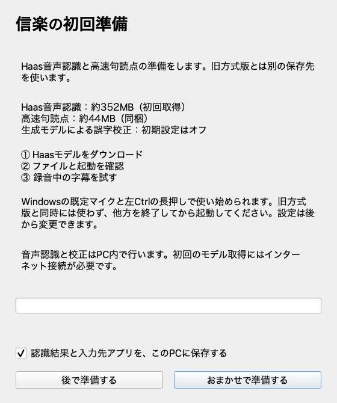
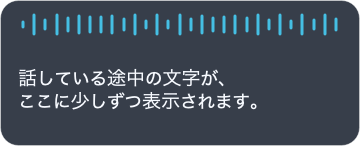
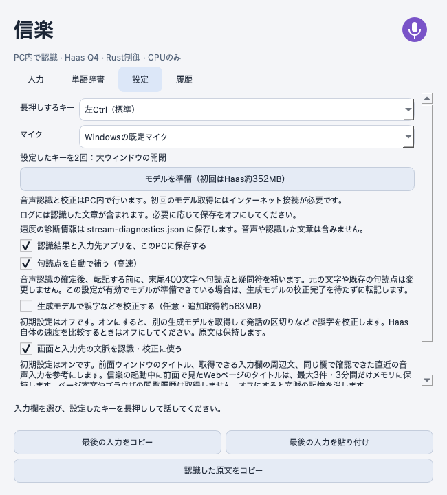

# Windows版の導入と操作

## インストール

このベータ版のセットアップ用exeにはコード署名がありません。Windowsの設定によっては起動できません。開く前に、下の[Windowsの警告への対処](#windows-security)を確認してください。

1. [Releases](https://github.com/k3peta/shigaraki/releases/tag/v0.1.0a6)から`Shigaraki-Windows-0.1.0a6-setup.exe`をダウンロードします。
2. 起動中の信楽の録音・処理を終え、トレイの終了メニューから閉じます。Haasテスト版からはそのまま更新できます。辞書・設定・ログ・取得済みモデルは引き継ぎます。以前の方式の信楽をアンインストールする必要はありません。
3. セットアップ用exeを開き、画面の指示に従います。アプリは現在のユーザーのフォルダへ入ります。
4. 最後の「続けてHaasモデルを準備する」を選んだまま終了します。初回は約352MBのHaas Q4_Kモデルを取得し、検証と読み込みを行います。句読点用のモデルとトークナイザー、合計約44MBは同梱しています。
5. 準備完了の表示を確認します。次回からは、デスクトップまたはスタートメニューの「信楽」から起動できます。

ダウンロード済みで正常なモデルは再利用します。準備に失敗したときは接続・空き容量・表示内容を確認し、「再試行」を使います。モデルの準備が完了するまでは録音を始められません。

## Windowsの警告への対処

警告の名前を確認してください。SmartScreenとSmart App Controlでは、できる操作が異なります。

### 「WindowsによってPCが保護されました」（SmartScreen）

1. ファイルが[信楽の公式Releases](https://github.com/k3peta/shigaraki/releases/tag/v0.1.0a6)から取得した`Shigaraki-Windows-0.1.0a6-setup.exe`であることを確認します。
2. 警告画面の「詳細情報」を選びます。
3. 配布元を信頼できる場合に限り、表示された「実行」を選びます。

「実行」が表示されない場合は、この手順では進めません。警告文を確認し、下の案内も参照してください。[Microsoftの説明](https://github.com/MicrosoftDocs/windows-dev-docs/blob/docs/hub/apps/package-and-deploy/publish-first-app.md#step-6-handle-smartscreen-for-new-apps)

### 「スマート アプリ コントロールが安全でない可能性のあるアプリをブロックしました」

「安全に実行できることを発行元が確認できなかったため、ブロックしました」などと表示される場合は、Smart App Controlによるブロックです。「詳細情報→実行」で続けることはできません。

この警告が出た場合、Smart App Controlをオンにしたままでは現在の未署名セットアップを起動できません。Microsoftによると、アプリ単位の例外許可はありません。[Microsoftの説明](https://support.microsoft.com/en-us/windows/security/threat-malware-protection/smart-app-control-frequently-asked-questions)

### 暫定手順：インストール後すぐに保護を戻す

2026年11月2日、利用者から、Windows 11 26H2でSmart App Controlを一時的にオフにしてa3をインストールし、再びオンにしても信楽が起動・動作したとの報告がありました。開発側での同条件の再現試験や、この版・すべてのPCでの確認はまだ行っていません。

この操作中はSmart App Controlの保護が一時的に働かなくなります。Microsoftは最近のWindows更新で再有効化できるようになったと案内しています。Windows Updateを適用し、自分の環境で再有効化できることを確認した場合に限り、次の手順を使ってください。設定画面に「再インストールしないとオンに戻せない」などの注意がある場合や、再有効化の可否が分からない場合は実施しないでください。

1. [公式Releases](https://github.com/k3peta/shigaraki/releases/tag/v0.1.0a6)から取得したセットアップ用exeを用意します。
2. 「Windows セキュリティ」→「アプリとブラウザー コントロール」→「スマート アプリ コントロールの設定」を開きます。
3. Smart App Controlを一時的に「オフ」にします。他の保護設定は変更しません。
4. 信楽のセットアップ用exeを実行します。完了画面の「続けてHaasモデルを準備する」は外して終了します。
5. すぐに同じ設定画面へ戻り、Smart App Controlを「オン」に戻します。
6. オンになったことを確認してから信楽を起動し、モデル準備と短い音声入力を試します。

オンへ戻せない、またはオンに戻すと起動・認識がブロックされる場合は、[Issues](https://github.com/k3peta/shigaraki/issues/new/choose)へ警告文と版番号をお知らせください。オフのまま使い続けることは案内していません。個人情報や入力した文章の提出は不要です。正式なコード署名を付けた配布は別途準備中です。

以前の方式の「信楽」も入っている場合、アプリ一覧に同名が並ぶことがあります。この更新版は0.1.0a6です。デスクトップの既存ショートカットは上書きしません。作成を見送った案内が出た場合は、スタートメニューの「信楽」フォルダー内の「信楽」から起動してください。

## マイクと小窓

Windowsのマイクの使用許可を確認します。信楽の「設定」で内蔵マイクなどの入力機器を選んでください。

入力したいアプリの欄にカーソルを置き、左Ctrlを長押しして話します。小窓に途中字幕が表示され、キーを離すと入力先へ貼り付けます。入力先の送信ボタンは押しません。

## 大ウィンドウと連続入力

録音していないときに左Ctrlを短く2回押すと、大ウィンドウを開閉できます。録音ボタン、または左Ctrl長押しで連続入力を開始し、もう一度操作すると停止して貼り付けます。大ウィンドウ表示中は小窓を出しません。

停止後も最後の認識に時間がかかる場合があります。転記に失敗したときは「最後の入力をコピー」から取り出せます。閉じる操作はOS標準のウィンドウボタンを使います。ウィンドウを閉じてもアプリはトレイに残り、トレイの終了メニューから終了できます。

## 設定と辞書

左Ctrlの代わりに左Altを選ぶこともできます。旧方式版とHaas版は同時に使わず、一方を終了して切り替えます。

初期辞書はOpenAI、ChatGPT、Codex、Antigravity、Claude、Geminiです。大学名などの個人用語は初期収録していません。以前から自分で登録していた単語は更新後も残ります。

「単語辞書」に、聞き取られた表記と入力したい表記を登録できます。ユーザー登録を初期辞書より優先します。辞書は認識候補と登録済みの表記補正に使いますが、必ず正しく認識されるわけではありません。旧方式版の辞書は自動でコピーしません。

高速句読点補完は初期状態でオンです。Qwenによる生成校正は初期状態でオフで、オンにすると約563MBのモデルを追加取得します。

## 削除と困ったとき

アプリをトレイから終了し、Windowsの「設定」→「アプリ」→「インストールされているアプリ」で、この版の「信楽」を削除します。辞書・設定・最後の入力・ログ・モデルは`%LOCALAPPDATA%\ShigarakiHaasPreview`に残します。

不具合の報告先は[Issues](https://github.com/k3peta/shigaraki/issues/new/choose)です。字幕が出ないのか、字幕は出るが転記されないのかを分けて教えてください。実際の音声や文章を提出する必要はありません。

このページの図は画面コードから生成したプレビューで、Windows実機のスクリーンショットではありません。
