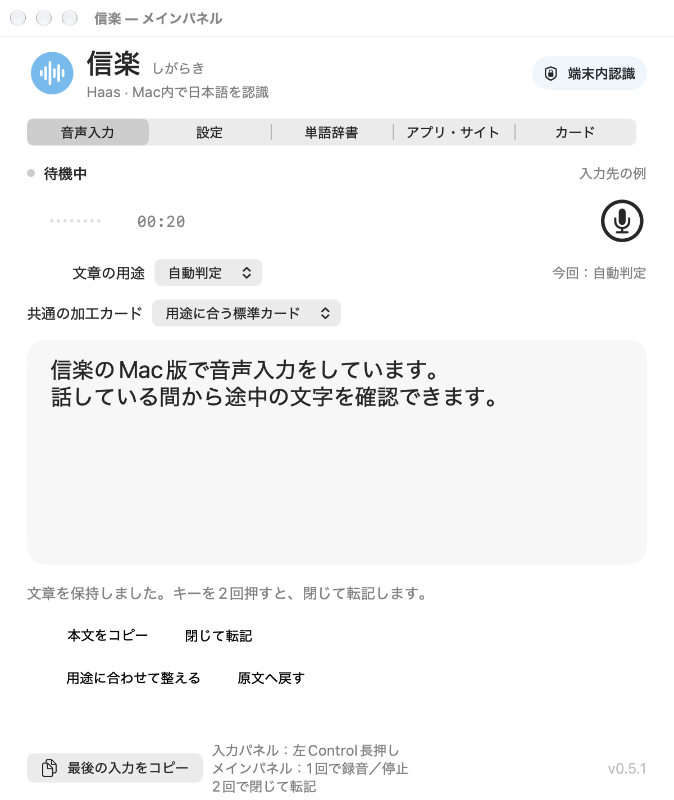
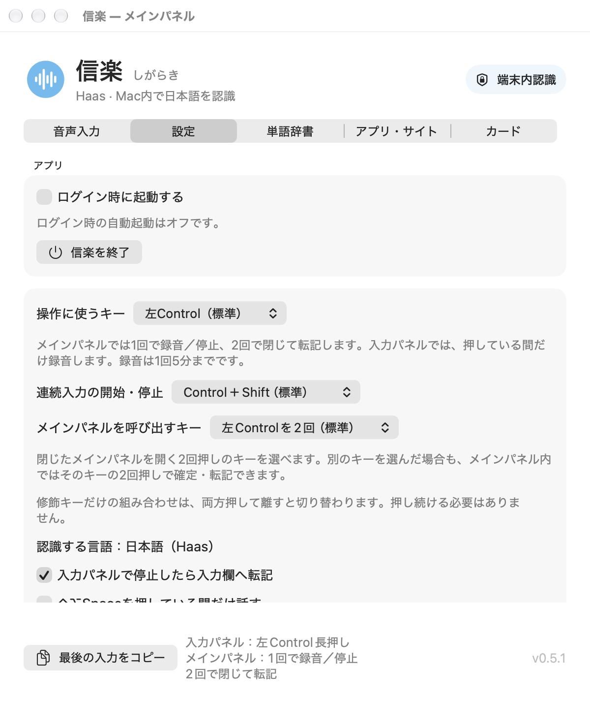
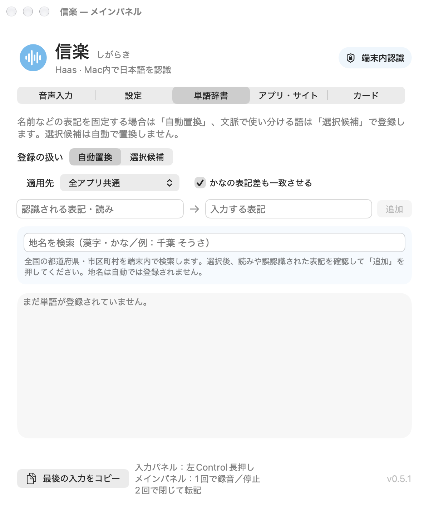

# 信楽（しがらき）操作マニュアル

v0.5.1（build 24）/ 2026年11月3日

## 押して話し、離すと入力

メインパネルを閉じている間は、左Controlを押している間だけ録音します。途中の文字は入力パネルで確認できます。Haasのモデルが短い音声を繰り返し認識するため、字幕は後から修正されることがあります。

入力パネルの外観は前版と共通のため、画像は前版の表示例です。

### 入力の3ステップ

1. メインパネルを閉じ、入力したいアプリの入力欄にカーソルを置きます。
2. 左Controlを単独で長押しし、そのまま話します。
3. 話し終わったらキーを離します。認識結果を確定し、入力欄へ一度だけ貼り付けます。

### 波形と入力パネルのボタン

波形が動くと、マイクが音を拾っています。右上にはコピー、歯車、録音・停止、閉じるボタンがあります。

入力パネルの×は表示を隠すボタンです。録音を終えるにはキーを離します。転記できると入力パネルが閉じます。メッセージの送信は行いません。

## 1回押して録音・停止、2回で確定

入力欄を選んで左Controlを素早く2回押すと、メインパネルを開けます。録音中は入力パネルを出さず、この画面に途中の文字を表示します。

メインパネルの音声入力画面です。1回押しで停止した本文は残り、続きを録音するか、2回押しで確定して転記できます。

### 長い文章を入力する

1. 入力先のアプリの入力欄にカーソルを置き、左Controlを素早く2回押します。
2. 左Controlを単独で1回押して離すと、少し待って録音が始まります。その後はキーを押し続けずに話せます。
3. もう一度1回押して離すと停止し、本文をメインパネルに残します。ここでは転記しません。再度1回押すと、改行して続きを録音できます。
4. 入力を終えるときは左Controlを素早く2回押します。最後の認識処理が終わるとメインパネルを閉じ、入力先へ一度だけ転記します。録音中や確定待ち中も、この操作を使えます。

### 録音アイコンと待ち時間

録音アイコンでも開始・停止できます。停止だけでは転記せず、認識した本文を残します。

録音開始は2回押しとの区別のため、キーを離してから約0.35秒待ちます。録音中の1回押しによる停止では、この待ちはありません。

## キーを選ぶ・画面を閉じる

タブの順番は、音声入力、設定、単語辞書、アプリ・サイト、カードです。メインパネルはタイトルバーをつかんで移動できます。

設定画面です。メインパネルは不透明、入力パネルは背景になじむ半透明の表示です。どちらも手前に表示します。

### 開く・閉じる

メインパネルが閉じているときは、左Controlを素早く2回押すと開きます。確定・転記・準備の途中でも、状態の確認に使えます。入力パネルでキーを押し続けて録音している間は無視します。

メインパネルが開いているときの2回押しは、本文を確定して閉じ、転記する操作です。左上の赤いボタンや⌘Wは、転記せずに閉じて本文を残します。録音中なら録音を中止します。閉じてもアプリはメニューバーに残ります。

### キーと自動起動

「操作に使うキー」は左Control、左Option、なしから選べます。入力パネルでは長押し、メインパネルでは1回押しの録音・停止と2回押しの確定に使います。「メインパネルを呼び出すキー」では、閉じたメインパネルを開く2回押しのキーを選べます。別のキーを選んだ場合も、メインパネル内ではそのキーの2回押しで確定・転記できます。

「設定」の「アプリ」欄で、「ログイン時に起動する」を切り替えられます。「信楽を終了」を押すと、メニューバーの常駐も終了します。

## 自動置換と候補を使い分ける

「単語辞書」で表記を登録できます。同じ読みでも意味が変わる語は、候補から選べる設定にします。

単語辞書の画面です。登録の扱いと適用先を選び、追加前に表記を確認できます。

### 単語を登録する

1. 表記を固定する語は「自動置換」、文脈で使い分ける語は「選択候補」を選びます。
2. 適用先を選び、認識される表記と入力したい表記を入れて「追加」を押します。
3. 選択候補は自動では置き換えません。認識後の本文で下線の語をクリックして候補を選びます。⌘Zで戻せます。

### 地名とユーザー辞書

地名辞書は表記を調べて登録するために使えます。ユーザー辞書のアプリ別設定を優先します。登録しても、毎回必ずその表記で認識されるとは限りません。

## 本文を確認して整える

音声認識と文章の整形は別の処理です。整形とカードの詳しい案内は、ヘルプメニューから開けます。

### 用途と加工カード

「文章の用途」と「共通の加工カード」で、メール・チャット・文書などの整形方法を選びます。「アプリ・サイト」でアプリごとに設定を変え、「カード」で独自の指示を保存できます。

「用途に合わせて整える」は、Apple Intelligenceの端末内モデルを使います。手動で整えた結果は自動転記しません。「原文へ戻す」で元の文章に戻せます。

「停止後に用途に合わせて整形する」は任意の設定で、初期状態はオフです。オンの場合は確定した文章を整形してから転記します。処理に失敗した場合や文章が1800文字を超える場合は原文を残します。

### 入力先の文脈を補足する

「アプリ・サイト」の「アプリ・サイト別の文脈（任意）」で、アプリやWebサイトへ話題・用語を登録できます。最大64件で、話題は400字、用語は1行1語で32語・各80字までです。

アプリは識別子、サイトはhttp・httpsのホスト名が完全に一致する場合に使います。サイトを確認できない場合や「アプリ名のみ」の設定では、サイト用の補足を使いません。用語は認識ヒントで、本文を機械的に置き換える辞書ではありません。

音声編集のボタン・設定キー・ショートカットは通常操作から外しました。本文の手直しや用途に合わせた整形、カードは引き続き使えます。

数字、固有名詞、否定、依頼や約束の強さが変わっていないか、最後に確認してください。

## 文字が入らないときも取り出せる

「最後の入力をコピー」は、メインパネルのどのタブでも下部に表示します。最後に確定・中止した認識結果を取り出せます。

### 転記できなかったとき

まず入力先の文字を確認します。転記を確認できなくても、実際には入っている場合があります。信楽はこの状態で自動再送しません。入っていない場合だけ、「最後の入力を貼り付け」かControl＋Option＋Vで再試行します。

「本文をコピー」は表示中の本文、「最後の入力をコピー」は最後の認識結果をコピーします。コピー後は入力先に戻り、⌘Vで貼り付けます。

メインパネルでは、2回押しによる確定時に、入力先のアプリの入力欄を確認してから転記します。入力欄・カーソル・既存の文章が変わった場合や、別のアプリを操作した場合は自動転記を中止し、認識した文章を残します。

### 認識した文字をログに残す

「設定」の「認識した文字をテキストログに保存」で保存を切り替えます。初期設定はオンです。「ログを開く」や「保存先」から記録を確認できます。

保存先はホームフォルダ内のLibrary/Application Support/信楽です。音声入力ログ.txtと音声入力ログ.jsonlに、日時、入力先アプリ、取得できたサイトのドメイン、用途、カード、転記結果、認識・整形後の文字を保存します。

録音データ、URLのパスや検索パラメータ、入力欄の前後の文章はログに保存しません。ログの整理やアーカイブは手動で行います。

### 突然終了したとき

ログ保存がオンの場合、通常の音声入力の最後の本文・原文・未転記の状態を「最後の入力.json」に保存し、次の起動時に復元します。外部文書や音声編集の本文全体は、この復旧ファイルには保存しません。

ログ保存がオンなら、「最後の認識.txt」にも約3秒ごとの途中経過を残します。突然終了した場合は、このファイルから取り出せます。最後の保存後の文字は残らない場合があります。

ログ保存をオフにすると新たなログや復旧ファイルは保存せず、文章は起動中のメモリだけに保持します。既存のログや復旧ファイルは自動削除しないため、必要に応じて手動で整理してください。

## 入力先・許可・待ち時間を確認する

字幕が出たことと、入力欄への転記を確認できたことは別です。転記後は、入力先に文章が入ったか確認してください。

### 字幕は出るのに転記されない

「設定」の「入力パネルで停止したら入力欄へ転記」をオンにし、「直接入力の許可あり」を確認します。メインパネルでは、1回押しの停止後は本文を残し、2回押しで確定したときに転記します。「許可を確認」からmacOSのアクセシビリティを許可できます。初回はマイクの許可も必要です。

パスワード欄や入力欄以外には貼り付けません。対応しないアプリや入力欄では、コピーして使ってください。録音中のキー入力や外部へのクリックは、入力先の変更として扱います。

### 停止後に少し待つことがある

最後の認識結果を確定してから転記します。自動整形がオンなら、さらに整形を待ちます。初回の音声モデル準備、Macの負荷、入力先のアプリによって時間は変わります。

入力パネル・メインパネルとも、1回の録音は5分までです。上限では自動転記せず、認識できた本文を残します。メインパネルで内容を確認し、次の録音で続きを追記できます。

### 端末内で処理する

音声認識にはHaas-ja-v1.0のQ4_K量子化モデルを使い、CPUで処理します。AppleのSpeechAnalyzer／SpeechTranscriberは使いません。文章整形は任意の別機能で、Apple Intelligenceの端末内モデルを使います。外部のフロンティアモデルへ音声・文章・カードを送る機能はありません。

macOS 26以降のApple Silicon Macが対象で、音声認識は日本語向けです。初回はHaasのモデル（約352MB）を自動で取得し、サイズとSHA-256を検証してから読み込みます。起動中はモデルを保持し、入力のたびに読み込み直す待ち時間を減らします。

### マニュアルを開く

メニューバーの波形アイコンやヘルプメニューから「操作マニュアル」「操作早見表」を開けます。アプリ内に保存したファイルなので、読むための通信は不要です。

入力パネル以外の掲載画面はv0.5.1のものです。初回準備、字幕、本文や波形は、説明用の状態を再現しています。macOSの外観設定により、色や見え方は変わります。
